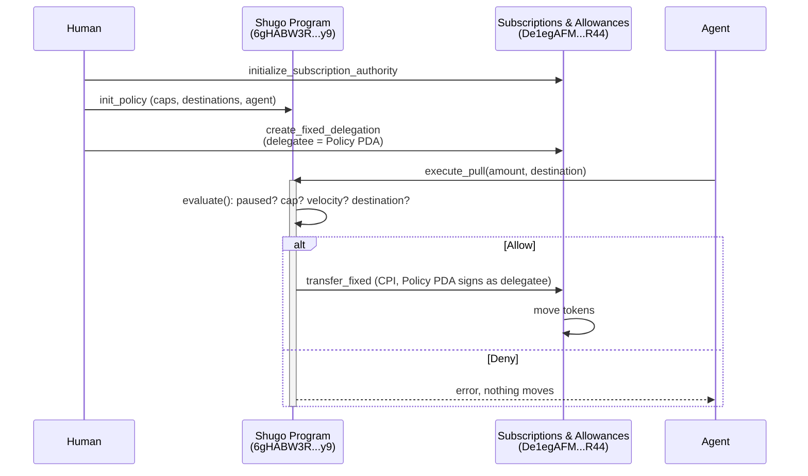

## Composition

Shugo is one Anchor program that composes with Solana's Subscriptions & Allowances program rather than reimplementing token custody. The only thing Shugo's program ever does to a token balance is CPI into S&A's own `transfer_fixed` instruction — it never moves a token directly.

The first three calls can be bundled into a single transaction — this is exactly what the CLI's `create-policy` command and the SDK's `createPolicyAndDelegation` do.

## The Policy account

One Policy PDA exists per `(human, mint, policy_id)` triple. Its own address is what gets registered as `delegatee` on the real S&A delegation — that registration is the entire mechanism. From that point on, S&A will only accept a `transfer_fixed` call where the signer is this exact address, and the only way to produce that signature is through Shugo's own `execute_pull`, which runs the policy checks first.

| Field | Type | Meaning |
| --- | --- | --- |
| `human` | `Pubkey` | Owns the policy, funds pulls, the only signer for `update_policy` and `pause`/`resume`. |
| `agent` | `Pubkey` | The only signer allowed to call `execute_pull` against this policy. |
| `mint` | `Pubkey` | The token this policy governs. |
| `per_call_cap` | `u64` | Maximum amount a single pull can move. |
| `velocity_cap` | `u64` | Maximum total amount across all pulls within one fixed window. See [Velocity Caps](/velocity-caps) for how windows reset. |
| `velocity_window_s` | `i64` | Window length, in **seconds** — a real Unix duration, not a slot count. |
| `window_start_ts` | `i64` | Unix timestamp the current window began. |
| `window_pulled` | `u64` | Amount already pulled within the current window. |
| `destinations` | `[Pubkey; 4]` | Allowed receiver token accounts. Fixed-size; only the first `destination_count` entries are meaningful. |
| `destination_count` | `u8` | How many of the four slots above are in use. |
| `paused` | `bool` | The kill switch. `true` denies every pull immediately. |
| `policy_id` | `u64` | Lets one `(human, mint)` pair hold several independent policies — one per agent, for example. |

PDA seeds: `["policy", human, mint, policy_id.to_le_bytes()]`.

## Instructions

| Instruction | Signer | What it does |
| --- | --- | --- |
| `init_policy` | human | Creates the Policy PDA with the initial caps, window, and allowlist. |
| `execute_pull` | agent | Evaluates the policy; on `Allow`, CPIs into S&A's `transfer_fixed`. |
| `set_paused` | human | The kill switch — one instruction, `true` pauses, `false` resumes. |
| `update_policy` | human | Changes `agent`, the two caps, the window length, or the allowlist. Deliberately leaves `window_pulled`, `window_start_ts`, and `paused` untouched — configuration and runtime state are different concerns. |

## Why the destination check lives in Shugo, not S&A

S&A's own `transfer_fixed` takes a receiver token account as a plain argument with no constraint tying it to anything set when the delegation was created — by design, S&A caps _how much_ and _until when_, not _where to_. A delegatee can redirect a pull to any token account of the right mint. Shugo's `execute_pull` adds exactly the check that's missing: the requested destination must be one of the policy's up-to-four allowlisted accounts, checked before the CPI ever happens, independent of anything S&A itself validates.

## Deployed addresses (devnet)

| Program | Address |
| --- | --- |
| Shugo | `6gHABW3Rn5dsTdXKN2xzRdb4g9v2DjYmc9sKq1Wn8my9` |
| Subscriptions & Allowances | `De1egAFMkMWZSN5rYXRj9CAdheBamobVNubTsi9avR44` |

## What's deliberately out of scope today

Two gaps are real and intentional, not oversights — see the [FAQ](/faq) for the full reasoning. `execute_pull` does not yet forward Token-2022 transfer-hook accounts, so hook-enabled mints aren't supported yet. `init_policy` does not yet validate that a mint is one Shugo can actually handle. Both are scoped, both have a clear extension point already built into the SDK (`resolveExtraAccountsForMint` and `checkMintSupported` in `@shugo/sdk`), and neither is a correctness or security gap in what's already shipped — a pull against an unsupported mint fails cleanly at the S&A CPI boundary rather than misbehaving.
