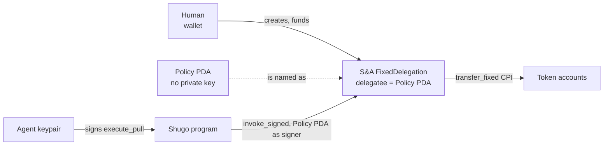

## The threat model

An autonomous agent that holds a private key to a funded wallet is a single point of failure in three distinct ways:

1. **Prompt injection** — something in the agent's input convinces it to construct and sign a transaction its operator never intended.
2. **Logic errors** — a bug or a bad model output computes a wrong amount or a wrong recipient.
3. **A compromised framework** — a vulnerability in whatever orchestrates the agent (LangChain, an MCP server, a custom runner) leaks the key outright.

In a wallet the agent directly controls, any one of these means the whole balance is at risk. Shugo's response isn't to make the agent's environment more trustworthy — it's to make the agent's authority narrow enough that none of the three can matter much even when they happen.

## Separating ownership from execution authority

The agent never receives funds, never holds an SPL token delegate authority, and never has any on-chain permission beyond "may call Shugo's `execute_pull` instruction." The actual authority to move tokens belongs to a **Policy PDA** — an account Shugo's program controls, with no private key at all.

The human grants that authority exactly once, by creating a real [Subscriptions & Allowances](https://github.com/solana-foundation/subscriptions) `FixedDelegation` and naming the Policy PDA's own address as `delegatee`:



From that point on, S&A will only honor a `transfer_fixed` call where the signer matches the address on file as `delegatee` — the Policy PDA. The agent's own keypair is never that signer. The only way to produce a valid signature from the Policy PDA is `invoke_signed` from inside Shugo's own program, which only happens after `execute_pull`'s policy checks pass. An agent with a leaked key, a bad prompt, or a wrong computed amount can sign all the transactions it wants — none of them can move a token unless they go through `execute_pull`, and `execute_pull` enforces the policy regardless of what the agent asked for.

## Instant revocation

Shugo adds a kill switch S&A doesn't have on its own. A delegation itself can only be revoked through S&A's own instructions, one delegation at a time — fine for a single relationship, unwieldy if a human has granted several delegations to the same agent across different mints or policies.

`set_paused` is Shugo's answer: one instruction, one signature from the human, and every future `execute_pull` against that policy is denied immediately — checked before anything else, including the amount or the destination.

```text
node dist/index.js pause --keypair ~/.config/solana/human.json --url "$RPC" --policy $POLICY
```

<Warning>
  Pausing a Shugo policy does not touch the underlying S&A delegation itself — the delegation still exists, still has an allowance left, and is still technically valid S&A state. What pausing removes is Shugo's willingness to CPI into it. If you want the delegation gone entirely, not just inert, S&A's own `revoke_delegation` instruction (not currently wrapped by the Shugo SDK) does that directly.
</Warning>

Resuming is the same instruction with the flag flipped:

```text
node dist/index.js resume --keypair ~/.config/solana/human.json --url "$RPC" --policy $POLICY
```

Both of these were run for real against live devnet during development — pausing a policy and then attempting a pull against it produces a genuine on-chain rejection (`AnchorError: Paused`), not a client-side check that could be bypassed by talking to the program directly. See the [Quickstart](/quickstart#7-the-kill-switch) for the actual transcript.
